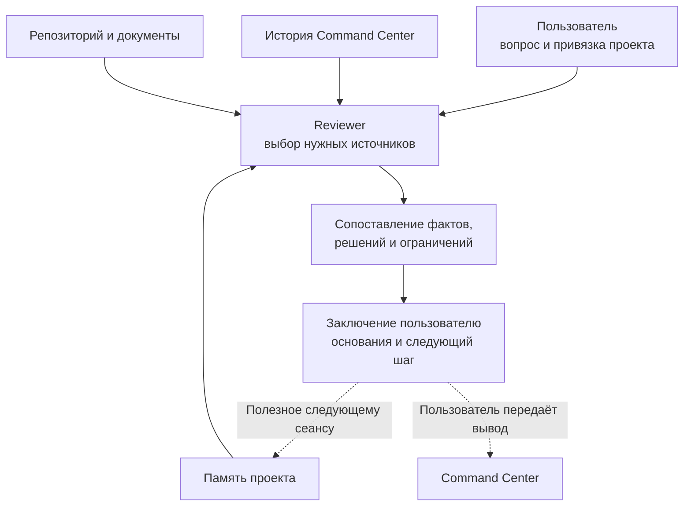
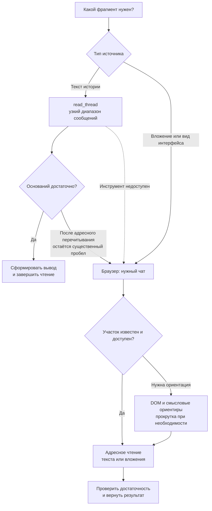

# 🤖 Reviewer Hub

**Независимая проверка решений, контекста и результатов работы с AI.**

[Задача](#зачем-нужен-reviewer) · [Пример](#учебный-пример) · [Устройство](#как-устроен-hub) · [Работа с вебом](#как-reviewer-читает-историю) · [Личный вклад](#личный-вклад)

Reviewer Hub — подключаемый рецензент для Command Center и работы над отдельными проектами. Он сопоставляет обсуждение команды, принятые решения и фактическое состояние репозитория, помогает обнаружить существенные расхождения и возвращает пользователю дополнительное экспертное мнение.

## Зачем нужен Reviewer

При длительной работе решения распределяются между чатами, документами и кодом. После паузы или смены разговора полезно восстановить основания и проверить, соответствует ли текущая работа согласованной задаче.

| Вопрос пользователя | Что проверяет Reviewer |
|---|---|
| «Это действительно реализовано?» | Сопоставляет заявленный результат с файлами и относящимися проверками |
| «Мы уже принимали такое решение?» | Находит нужный участок обсуждения и основания решения |
| «Не ушли ли мы от первоначальной задачи?» | Сверяет цель, ограничения и фактический объём работы |
| «Можно ли продолжить в новом чате?» | Восстанавливает решения, текущую позицию и существенные открытые вопросы |
| «Есть ли другой разумный вариант?» | Проверяет аргументы и предлагает существенную альтернативу |

Проверка начинается с конкретного вопроса. Reviewer выбирает необходимые источники и завершает чтение, когда оснований достаточно для ответа.

## Учебный пример

В синтетическом проекте принято ограничить ожидание ответа **10 секундами**, а в конфигурации указано **30**. Reviewer сопоставляет решение с файлом и показывает конкретное расхождение.

| Источник | Что в нём |
|---|---|
| [Решения проекта](examples/demo-project/DECISIONS.md) | Принятое ограничение — 10 секунд |
| [Конфигурация](examples/demo-project/repository/src/config.py#L3) | Фактическое значение — 30 секунд |
| [Память проекта](examples/demo-project/PROJECT_CONTEXT.md) | Задача, решения и точка продолжения |
| [Заключение Reviewer](examples/demo-project/REVIEW.md) | Вывод с основаниями и рекомендуемым следующим шагом |

Пример показывает проверку соответствия решения и реализации. Его учебная память не становится активной привязкой Reviewer.

## Как устроен Hub

| Часть | Ответственность |
|---|---|
| [AGENTS.md](AGENTS.md) | Контракт роли: выбор источников, порядок проверки, полномочия и ответ |
| [Справочник Command Center](docs/COMMAND_CENTER_REFERENCE.md) | Термины, процесс и границы решений внешней системы |
| `projects/<project_id>/PROJECT_CONTEXT.md` | Курируемая память конкретного проекта: привязки, решения, развилки и точка продолжения |

Один постоянный чат Reviewer связан с одним активным проектом. Пользователь задаёт его идентичность, путь к репозиторию и ссылку на чат Command Center, если он используется. Затем Reviewer опирается на сохранённую привязку и задаёт уточнения при неоднозначности.

Для нового подключения предусмотрен [шаблон проектной памяти](templates/PROJECT_CONTEXT.md). Рабочая память помогает продолжать проверку после паузы или сжатия контекста. В неё попадает долговременно полезное содержание со ссылками на основания. Канонические решения и состояние проекта остаются у своих владельцев.

## Как Reviewer читает историю

Отдельная часть разработки — исследование чтения длинных чатов через внутренний браузер. История может подгружаться частями: в DOM одновременно присутствует только участок разговора. Поэтому протокол разделяет **поиск ориентира**, **чтение нужного содержания** и **восстановление недоступного участка**.

Итоговый маршрут объединяет структурированную историю и браузер:

В браузере используются три взаимодополняющих приёма:

| Приём | Когда нужен | Что даёт |
|---|---|---|
| Адресное чтение текста — `innerText` / `textContent` | Нужное сообщение или участок уже найден | Содержание для проверки без выгрузки всей страницы |
| Ориентация по DOM | Нужно найти далёкий участок или понять структуру разговора | Ограниченный набор ориентиров: сообщения, навигация, Stage и фаза работы |
| Восстановление через DOM и прокрутку | Нужный участок ещё не подгружен из-за виртуализации | Переход к нужному месту и повторное адресное чтение |

Текст истории сначала читается через `read_thread`. Браузер подключается для вложений, визуального состояния, недоступности инструмента истории или существенного пробела в структурированной выдаче. Плашки Stage и другие метки помогают ориентироваться; найденный фрагмент проверяется по содержанию.

Обрезанный ответ инструмента перечитывается меньшим диапазоном. Временный cursor используется для навигации. Завершение чтения определяется достаточностью данных для текущего вопроса.

## Роль в Command Center

| Участник | За что отвечает |
|---|---|
| Пользователь | Цель, приоритеты и окончательное человеческое решение |
| Command Center | Архитектурное обсуждение, план и принятие результата |
| Executor | Выполнение поставленной задачи в целевом репозитории |
| Reviewer | Дополнительная проверка аргументов, контекста и фактического результата |

Обычная проверка Reviewer проходит в режиме чтения; при необходимости обновляется собственная проектная память. Изменение целевого проекта выполняется по отдельной явной задаче. Заключение возвращается в чат, а пользователь при необходимости передаёт его в Command Center.

## Что было проверено при разработке

| Этап | Полученный результат |
|---|---|
| Исследование браузера | Выявлена виртуализация истории; принят переход от смысловых ориентиров к адресному чтению |
| Первый живой review | Уточнён выбор источников и разделены контракт роли, справочник и память |
| Проверки структурированной истории | Проверены свежий хвост, последующие сообщения и переходы к ранней истории через cursor |
| Сборка гибридного маршрута | Принят `read_thread → Browser → DOM/scroll recovery` с проверкой достаточности |

Это результаты исходных проверок в использованной среде. Описание сохраняет принятый подход к чтению и восстановлению контекста.

## Личный вклад

- Спроектирована роль независимого рецензента и её место в Command Center.
- Разделены контракт роли, справочник внешнего процесса и проектная память.
- Исследовано чтение длинных чатов через браузер, включая DOM, текстовое извлечение и виртуализацию.
- Выстроен гибридный маршрут получения истории с адресным браузерным восстановлением.
- Определены критерии достаточности данных, остановки чтения и проверки обрезанных результатов.
- Оформлены правила привязки проектов, сохранения памяти и восстановления работы между сеансами.
- Закреплены границы review, выполнения изменений и принятия решений.

## Основа проекта

Reviewer Hub реализован как файловый контракт роли и рабочее пространство для AI-агента. Инструменты чтения чатов, браузер и доступ к локальным файлам предоставляет среда исполнения. В репозитории собраны правила, которые связывают эти возможности в последовательный процесс проверки.

Реальные привязки, память и результаты хранятся локально в `projects/` и исключены из Git. Заказанные результаты относятся к `projects/<project_id>/output/`, отчёты — к его `output/reports/`.
