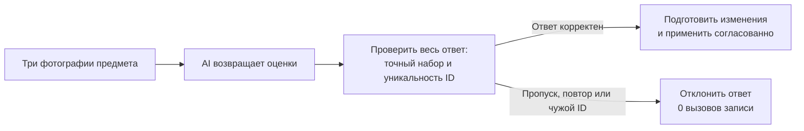

# Как безопасно применить AI-оценку фотографий

> Обезличенная адаптация сохранённого инженерного Review. Реплики, идентификаторы и минимальный код реконструированы для показа найденной проблемы.

Сервис составляет описание предмета по фотографиям. Перед основным анализом AI проверяет качество трёх снимков:

| ID | Снимок |
|---|---|
| `front` | Общий вид |
| `back` | Обратная сторона |
| `mark` | Клеймо или маркировка |

Backend знает состав отправленного набора. Модель возвращает оценки с `photo_id`, а обработчик сохраняет их.

**Вопрос из обсуждения:** достаточно ли сопоставлять каждую оценку по ID и проверять количество строк?

## Где возникает ошибка

Ожидаются `front, back, mark`. В ответе пришли `front, back, front`.

Количество совпало — три строки. Но `front` повторился, а `mark` отсутствует. Поэлементный обработчик уже вызывает запись, хотя ответ целиком принимать нельзя.



## Пройти кейс

| Материал | Зачем открыть |
|---|---|
| [Обсуждение и контракт](DISCUSSION.md) | Понять предложение команды и принятую границу |
| [Память проекта](PROJECT_CONTEXT.md) | Восстановить вопрос и необходимые источники |
| [Минимальный обработчик](repository/quality.py) | Увидеть запись до полной проверки и вариант с предварительной валидацией |
| [Заключение Reviewer](REVIEW.md) | Сопоставить основания и получить инженерный вывод |

## Воспроизвести

Из корня Reviewer Hub:

```text
python examples/photo-review/replay.py
```

Прогон считает обращения к записи в локальном стенде, без БД и вызовов AI.

| Ответ модели | Поэлементный обработчик | Предварительная проверка |
|---|---:|---:|
| Точный набор, другой порядок | 3 вызова | 3 вызова |
| Пропущена одна фотография | 2 вызова | 0 вызовов |
| Повторный ID вместо третьей фотографии | 3 вызова | 0 вызовов |
| Посторонний ID | 3 вызова | 0 вызовов |

Позднее в исходном проекте была добавлена проверка точного набора ID до любых записей. Последующий Review подтвердил её наличие.
